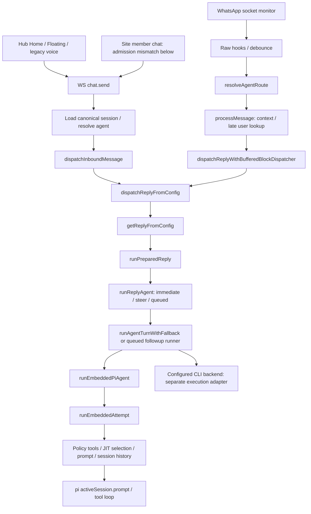

# Web and WhatsApp shared-engine reconnaissance

Read-only source report, 2026-10-22. The useful next location is the gateway's existing primary reply engine: web chat and WhatsApp already converge there. A second frontend classifier would not repair the common execution boundaries described below. The first-wave runtime remains unchanged; only the separately authorized handoff comments below were added afterward. Engine repairs remain recommendations for a separately reviewed continuation, not additional current acceptance requirements.

## Authorized handoff-comment completion

After the read-only recon and independent review, the parent authorized applying the reviewed comment-only patch to satisfy the open-items ledger. Commit `aed7f172704247b1fe993c204c9da4c7b609f370` adds nine comment lines across `src/agents/pi-embedded-runner/run.ts`, `src/auto-reply/reply/get-reply-run.ts` and `src/auto-reply/reply/queue/types.ts`. Each exact-site `TODO(handoff)` points to `proposals/2026-10-22-agent-decision-and-proactivity-experiments.md`, section “Shared web and WhatsApp engine follow-up”. The proposed engine behavior remains **unimplemented**. No push/merge was performed by the gateway agent.

Focused format check, type-aware lint, commit hooks and `git diff --check` passed. [Comment-only proof](comment-only-proof.json) compares the parsed TypeScript syntax trees against `7fac6744ea9`; all three are equal after excluding comments/positions. [Checks](comment-handoff-checks.json) record the exact scope. Twenty unrelated tracked dependency-wrapper modifications remain untouched and outside the commit. Runtime suites were not repeated for this comment-only syntax-identical change.

The [original reviewed report](report.reviewed-7fac6744ea9.md), source manifest, numbered anchors, original probe logs and original source-status artifact below remain the **historical reviewed snapshot at `7fac6744ea9`**, rather than silently being rewritten around the comment commit. Three current file hashes therefore differ only by these comments; the portable historical probe intentionally requires a matching `7fac6744ea9` checkout and rejects the newer candidate. Use the separate comment-only proof to relate the two revisions.

## Evidence and scope

Gateway checkout: `/home/nikolas/.cache/codex-implementation/2026-10-22-agent-harness-wave1-7k23gajh/minion`, HEAD `7fac6744ea9f15fb64b0423bd4f3c39592b3e6a7`. Engine files listed in [source manifest](source-manifest.json) match the approved baseline `6d1cd8836ff7b82d21668c50cc20b9b6d1e79c18`; Slice10's additive transport metadata does not change them. [Numbered excerpts](source-anchors.txt) preserve the inspected anchors; [source status](source-status.txt) records no gateway product-source modifications in the inspected paths. Hub/Site exact pins and dirty-source qualifications are in the independent [crosscheck](hub-site-crosscheck.md).

No credentials, providers, real users or live gateway were accessed. The two executable characterization tests passed against actual source with model execution/reply delivery mocked: [test](engine-boundaries.test.ts), [config](vitest.engine-recon.config.mts), [log](offline-probes.log). A separate [AST inspector](inspect-engine-boundaries.cjs) and [output](source-boundary-probes.json) establish explicit parameter omissions; that is source-structure proof, not a completed model/tool run. Two initial external-test configuration failures are retained as configuration logs; they collected no tests. The initial recon changed no product source. The authorized later comment commit above adds handoff markers only; no product fixes or spec changes were implemented.

## Actual pipeline



- **Web admission and acceptance:** `src/gateway/server-methods/chat/handlers.ts:193` accepts `chat.send`; `:244` loads the session, `:251` uses the client idempotency key as accepted run ID, `:294` registers its abort controller and `:307` acknowledges `started` before reply work. `:320` constructs internal `webchat` context; `:339` resolves the agent; `:366` dispatches with run ID and signal. The UUID is correlation/deduplication, not authority. Attachments are parsed at `:231` before this admission. `chat.abort` at `:129` supports exact run/session matching.
- **WhatsApp admission and routing:** `src/web/inbound/monitor.ts:122` keys its debouncer by account/conversation/sender, invokes raw hooks per entry, then `:239` combines bodies by spreading the last message. `src/web/auto-reply/monitor/on-message.ts:73` resolves account/peer bindings; `:118` refuses no-agent routing. `process-message.ts:462` constructs the transport context, `:499` attaches a mapped Hub user, and `:641` enters the buffered provider dispatcher. This is the WhatsApp Web/Baileys path, not every Cloud/WATI producer.
- **Shared execution:** `src/auto-reply/dispatch.ts:35` and `reply/dispatch-from-config.ts` converge on the existing resolver; `get-reply.ts:64` resolves the session agent, `:71` intersects skill filters, `:79` selects defaults, `:128` performs optional media/link understanding and `:186` applies session/directive configuration. `get-reply-run.ts:522` prepares the run; `agent-runner.ts:222` may steer or queue; `agent-runner-execution.ts:159` performs provider/model fallback, `:170` supports CLI backends and `:258` builds the primary embedded invocation.
- **Primary runtime:** `src/agents/pi-embedded-runner/run.ts:138` serializes session/global lanes, resolves model/hooks/privacy/tool pin, and `:626` calls `runEmbeddedAttempt`. `run/attempt.ts:109` creates the environment and session, `:129` sanitizes/limits history, `:551` emits `llm_input` with actual model/history and `:593` calls `activeSession.prompt`. Existing SDK history/compaction remains relevant: this is not isolated one-message inference.

The old gateway `ui/src/ui/controllers/chat.ts` is absent from both pinned/current trees. Commit `6d0332ae761` removed the legacy control UI. `src/gateway/control-ui.ts:205` and `src/infra/control-ui-assets.ts` retain configured/external asset support, but no supplied current asset bundle can establish its browser send/Stop behavior. Historical controller code is not current client evidence. The current, inspectable browser clients are Hub and Site; see the crosscheck for their exact ingress/auth/event handling.

## What each classifier/router actually controls

| Boundary | Current role | Consequence for transcript ideas |
|---|---|---|
| Hub `turn-router.ts` → `/api/assistant/route` | Jev classifies UI intent/context manifests, with off/shadow/enforce fallback; it does not choose the primary model or agent. | Existing Slices1–5 concern browser preparation, context application and classifier joins. |
| Gateway `get-reply.ts:248` → `smart-routing.ts:524` | Opt-in zero-LLM heuristic changes primary provider/model, nominal no-tool mode, context/time parameters; first result is session-pinned for four hours. | Evaluate this actual seam before introducing a learned/Jev model router. A short destructive instruction currently takes ECO before complexity checks; probe proves selection, not task failure. Sticky routing is explicitly intentional, so its suitability is an experiment, not automatically a bug. |
| Embedded model resolution `run.ts:216` | Plugin model overrides, privacy override (`:266`), tool-native-model pin (`:273`), then actual model lookup; outer fallback can change the model again. `models/tool-model-pin.ts:59` also includes `webchat`. | A UI/router decision is not the completed-run model receipt. Record candidate, override reason and actual attempt separately. |
| `tool-search/apply-selection.ts:89` | L1 permission filtering, followed by optional L2 embedding/lexical relevance selection; default mode is shadow (`:33`). | Tool relevance may optimize within an authorized registry; it must not grant permissions. |
| `attempt-session.ts:120,194` | Complete permitted registry is retained while initial active schemas are restricted; discovery activates tools in the same run. | Measure initial schemas, discovery activations, actual calls and task outcomes, rather than creating another catalog. |
| Drones/watchers | `src/drones/registry.ts` and `host.ts` run bounded secondary tasks; watcher classification/suggestions are separate consumers. | Approved Slice16 fixes opt-in watcher/drone usage; it does not fix all primary-run inference receipts. No Jev gate was found on the traced primary engine path. |

`src/routing/multi-llm-router.ts` and `src/agents/tool-router.ts` are utility implementations with no production import/call found in `src`/`extensions`. Their presence is not evidence that either is the active engine router. Existing debugger/lifecycle hooks likewise are not Jev classifiers.

## Findings and contract gaps

| ID | Evidence | Classification and practical limit |
|---|---|---|
| E1 | `buildTemplateSenderContext` (`agent-runner-utils.ts:207`) forwards the resolved user for immediate runs; `followup-runner.ts:141` omits it. More deeply, the explicit `run.ts:626` → `runEmbeddedAttempt` object omits `resolvedHubUserId`, sender ID/name/username/E164 and permission level for **all** embedded turns. No spread restores them. `attempt-env.ts:133` expects these fields when creating tools. | **Confirmed source parameter loss**, with executable queued-boundary characterization and AST proof of the common omission. This is a capability/identity propagation defect, not proof of privilege escalation. `minion-tools.ts:225,430` consumes the user for GWS/custom/plugin context; `custom-tools.ts:248` only injects `MINION_USER_ID` when present. `extensions/gmail-calendar/src/gws-runner.ts:187` explicitly rejects missing user ID and does not recapture it from agent/sender. Hub query tools may independently authorize by agent; do not claim every backend capability is broken. Full tool-execution parity is untested. Owner/permission fields are also absent at some earlier boundaries; do not attribute those solely to queuing. |
| E2 | `get-reply.ts:294` produces `smartRouteDisableTools`; `get-reply-run.ts:203` uses it for prompt text/memory snapshot but not the prepared run. `agent-runner-utils.ts:157` and the primary invocation do not carry `disableTools`. `attempt-env.ts:114` creates tools unless the actual embedded parameter is true. | **Confirmed nominal no-tool optimization is not enforced by the tool array.** The prompt says tools are disabled while permitted tools remain available. This is not an RBAC bypass: downstream permission gates remain. Reconcile the intended optimization before evaluating savings/quality or calling it no-tool execution. No live tool invocation was attempted. |
| E3 | `agent-runner.ts:231` returns immediately after enqueue. `FollowupRun` (`queue/types.ts:22`) stores message/origin fields but no accepted request ID or abort signal. `followup-runner.ts:117` creates a fresh UUID; its model call omits the original signal. `handlers.ts:397,442,467` can finalize/cache/retire the accepted request once dispatch has merely queued work. | **Confirmed execution-ID/cancellation association gap for a proposed unified accepted-turn contract.** A new execution UUID is reasonable for background work and is not itself a bug. The missing relation/controller means exact abort by the acknowledged request does not directly own the queued execution. The runner captures the active/draining turn A’s options (`agent-runner.ts:255`), so inheriting A’s signal into queued B would itself be wrong. The probe characterizes omission of those drainer options; it does **not** prove cancellation of B. The missing B lifetime contract is source-backed by its absent queue identity/controller and the handler’s retirement path, without a full WS queue/Stop reproduction. The auto-reply channel `/stop` handler does clear followups and lanes (`abort.ts:239`); WS `chat.send` intercepts `/stop` earlier (`handlers.ts:265`) and uses the chat controller registry instead. Exact `chat.abort` also follows that registry path; do not equate these cancellation paths. Preserve distinct acceptance/execution IDs and add per-item lifetime rather than inherit the drainer signal. Steered messages need separate semantics too. |
| E4 | WhatsApp route lookup (`on-message.ts:73`) receives no resolved user; `resolve-route.ts:488` needs that user to select its personal tier. User lookup only occurs at `process-message.ts:499`, after route/no-agent decisions. | **Confirmed source ordering prevents personal-tier selection from a mapped sender alone.** Explicit bindings can still work. This was already identified in the October16 parity proposal and remains in this pinned source; do not duplicate its authority design or claim it shipped. |
| E5 | WhatsApp raw messages are distinct, but combined context uses `{...last, body: combinedBody}` (`inbound/monitor.ts:239`), without certified original units. | **Explicit uncertified transport gap.** Slice10 certifies Telegram only. Do not apply Telegram cross-hook deduplication or watcher Jev eligibility to this WhatsApp batch. A WhatsApp adapter requires its own text/media/edit/identity producer tests. |
| E6 | Site sends role `member`, scopes `member.read/member.chat`; gateway method admission (`server-core/server-methods.ts:232`) rejects non-operator roles. | **Confirmed source interoperability mismatch**, independently checked by the peer report: `server/ws-connection/message-handler.ts:378` accepts only operator/node and closes member connections with code1008 (`:385`) before dispatch. This is not evidence of deployed Site behavior or a reason to weaken gateway authorization. |

A separate source concern is global `chat:<idempotencyKey>` cache/active-run lookup before session binding (`handlers.ts:277–292`). No payload/session-collision probe was run; treat scope binding as a review/test requirement for E3 rather than a separately confirmed exploit.

## Existing durability and accounting boundaries

The gateway already has persisted session transcripts, cron state and an in-flight SQLite store; it does not need a replacement agent runtime. The ordinary follow-up queue is an in-memory Map (`queue/state.ts:24`). The in-flight row starts only inside the embedded lane (`run.ts:158`), so it does not durably own waiting followups or all accepted WS requests.

Crucially, `in-flight-turns/recovery.ts:1` states recovery sends an apology, **not** automatic model replay. `:95` drops stale/looping rows and `:122` deletes after its best-effort attempt even if delivery failed. The run.ts replay comment describes more than this implementation. Do not infer replay/effect receipts from the table name. `platform/cron/isolated-agent/run.ts:462` reaches model fallback/embedded execution through its own adapter; approved Slices19–20 own the explicit-agent cron binding/receipt changes, not ordinary chat queue persistence.

Primary `run.ts:694,1165` accumulates usage and `:1176` returns agent metadata; `agent-runner.ts:412,426` persists session usage and emits optional diagnostics. `run.ts:1306` uses session correlation with run metadata. That is useful instrumentation, not an append-only per-provider-attempt bill/effect ledger. Failed fallbacks, overrides, cancellations and secondary media inference need explicit coverage before task-level savings claims. Existing `llm_input`/output hooks and run/attempt boundaries are candidate observation sites; do not add paid gates solely to instrument them. Drones host inference from last key resolution (`drones/host.ts:32`) is a separate approved Slice16 problem.

## Current spec coverage versus proposed continuation

| Already owned by reviewed October22 spec | Additional common-engine delta |
|---|---|
| Slices1–3: Hub Home/Floating pending preparation, exact accepted abort and UI callback lineage. | E3 ordinary gateway queue/steer lineage and exact cancellation ownership; Site and legacy voice lifecycle require their own adapter qualification. |
| Slices4–5: classifier/applied-decision correlation and unknown-cost semantics. | Apply compatible event vocabulary to primary engine model attempts, accepted→executing relations and actual tool/context choices; browser telemetry alone cannot establish them. |
| Slice10: optional transport carrier and Telegram originals; Slices11–15: certified watcher receipts/delivery only. | E5 WhatsApp canonical producers/batches; never silently expand certification or generic delivery recovery. |
| Slice16: opt-in resolved-model accounting for watcher/drone invocations. | Actual primary pi/CLI attempt chain and costs through overrides/fallback/abort, including secondary media inference. |
| Slices19–24,32: bounded Pulse approval/digest jobs, leases, publication and collection. | Normal chat waiting/execution lifecycle and effect-specific recovery contract; reuse existing components without treating every chat as a durable job. |
| Slices26–31: fixture trajectories, corpus, economics, trace screening and explicit live adapter. | Add Web/WhatsApp bridge adapters and primary model/tool/context seams as evaluated targets. The current synthetic fixture harness does not automatically exercise this production engine. |
| October16 WhatsApp personal-assistant proposal/spec (separate scope). | Reconcile E1/E4 with that work; retain same agent/current RBAC, backend capabilities and transport confirmations. No implicit activation or policy reuse. |

The earlier isolated WhatsApp worktree contains `personalChatAbortRequest` and `personal-source` imports absent from the pinned current chat handler. Its partial source/earlier tests are not current shipping evidence. No older artifact is superseded by this report.

## Bounded proposal recommendations

**P1 — Preserve execution identity and authorized tool context at the common engine boundary.** AS-IS: E1 loses optional user/sender fields; E2 advertises no-tools in prose without passing the runtime switch. TO-BE: frozen, server-derived turn context reaches both immediate and queued engine adapters; no-tools has one explicit, tested meaning. DELTA: first audit all typed producers/consumers, then forward a minimal typed carrier across preparation, queue and run→attempt; never deserialize an authoritative principal from arbitrary client text. Acceptance: actual immediate and queued runs with stub tools preserve fixture user/sender context; absent identity stays fail-closed; distinct users cannot cross scopes; native no-tools exposes zero tools, ordinary runs retain permitted discovery, and fallback keeps the declared policy. Include CLI compatibility, current SDK signatures and no real credentials. This repairs existing behavior before adding a classifier.

**P2 — Relate accepted requests to queued/steered executions and exact cancellation.** AS-IS: E3 has an acknowledged UUID, detached queue and new execution UUID. TO-BE: each accepted request has a bounded terminal disposition plus explicit execution/parent relation, preserving distinct IDs where useful. DELTA: define accepted/queued/steered/executing/completed/canceled/indeterminate semantics using current controller/session machinery; decide durability only where user-visible guarantees require it. Acceptance: actual WS handler with deferred active turn, second queued send, exact Stop before drain, newer send and reconnect; zero execution for canceled queued work, no cross-session/actor cancel, honest unknown completion after dispatch, no premature final that hides later execution, preserved origin delivery. No rollback or exactly-once billing claim.

**P3 — Observe and evaluate actual primary model/tool/context decisions.** AS-IS: UI manifests, heuristic pin, model overrides, tool-model pin, JIT discovery and completed usage are separate facts. TO-BE: a fixture trajectory joins these facts to task receipts and known/unknown costs. DELTA: add bounded observation records at existing run/attempt, llm_input and discovery/tool-result seams; compare current baseline with routing/JIT candidates using the approved fixture harness. Acceptance: short-followup after greeting, long/complex turn after ECO pin, page/scope switch, tool discovery, provider fallback, model override, compaction, rejected/failed tool and canceled run. Record real attempt model, loaded/called tools, context revision, success evidence and all costs; unknown receipts prevent promotion. Shadow first; no automatic Jev selection, weights or paid activation. Model-schema shortlisting is the optimization target, RBAC remains authoritative.

**P4 — Qualify WhatsApp as an adapter to the same personal engine.** AS-IS: E4/E5 and existing separate parity work. TO-BE: verified private transport resolves the existing personal agent/current authority before dispatch, preserves originals, shares authorized backend tools, and renders browser-only actions honestly as supported interactions/links. DELTA: reconcile with October16 scope rather than create another personal agent or action catalog; add source-backed WhatsApp text/media/debounce producer certification and common-engine conformance cases. Acceptance: same fixture user/agent/org capability through web and WhatsApp, no-binding/no-claim/revoked-member fail closed, group/shared-number policy enforced, equal message IDs across accounts/chats distinct, ordered originals preserved, cross-transport confirmations rejected, browser closed for backend tools. Deployment/real WhatsApp operation remains separately authorized.

Priority: P1 first; P2 before claiming exact queued Stop; P3 establishes whether model/tool/context routing helps; P4 completes transport parity through the same seams. This report supplies recommendations and acceptance outlines only. Parent owns source-backed proposal extension/status. [Comment-only handoff patch](handoff-comments.patch) was subsequently applied in the authorized comment commit above and introduces no current behavioral spec obligation. Its pointer is the existing proposal section “Shared web and WhatsApp engine follow-up”.

## Reproduction

The preserved original test/config and static inspector contain the recorded checkout path. Use [rerun.mjs](rerun.mjs) for another matching checkout: it verifies exact recorded HEAD, all 31 source hashes and a lockfile matching that HEAD, then rewrites imports into an owned temporary directory. Preserved artifacts and gateway files remain untouched; temporary files are removed after exit. Install the frozen declared dependencies separately before the test command. The source/lock checks do not independently certify installed package bytes.

From this evidence directory:

```sh
MINION_ENGINE_SOURCE=/path/to/matching/minion node rerun.mjs --validate-only
MINION_ENGINE_SOURCE=/path/to/matching/minion node rerun.mjs --inspect
MINION_ENGINE_SOURCE=/path/to/matching/minion node rerun.mjs --run
```

Portable validation and the static-probe branch passed against the recorded checkout: [validation](portable-validation.log), [static output](portable-static-probes.log). The portable `--run` branch was prepared without repeating the import-heavy test suite during concurrent Hub validation. Its underlying preserved source test was already executed: 1 test file / 2 characterization tests passed, 26.98s; drainer wording/variable names were clarified after review without changing assertions. The original exact-path invocation remains in [test log](offline-probes.log) / [config](vitest.engine-recon.config.mts).

These probes reproduce inspected boundary behaviors, not full Web/WhatsApp runtime parity or deployed incidence. Existing product checks were not rerun for read-only evidence. [Independent review](independent-review.md) accepted this as bounded source reconnaissance, with the queue and authority distinctions retained.
